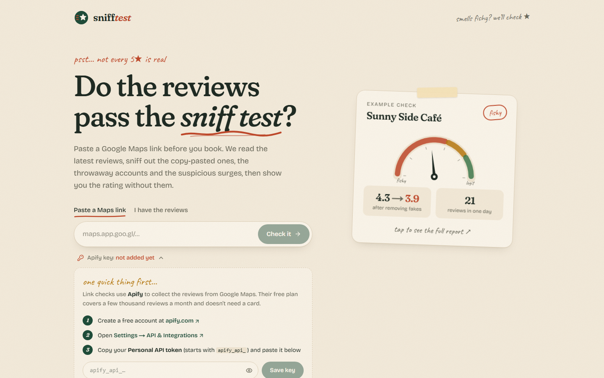
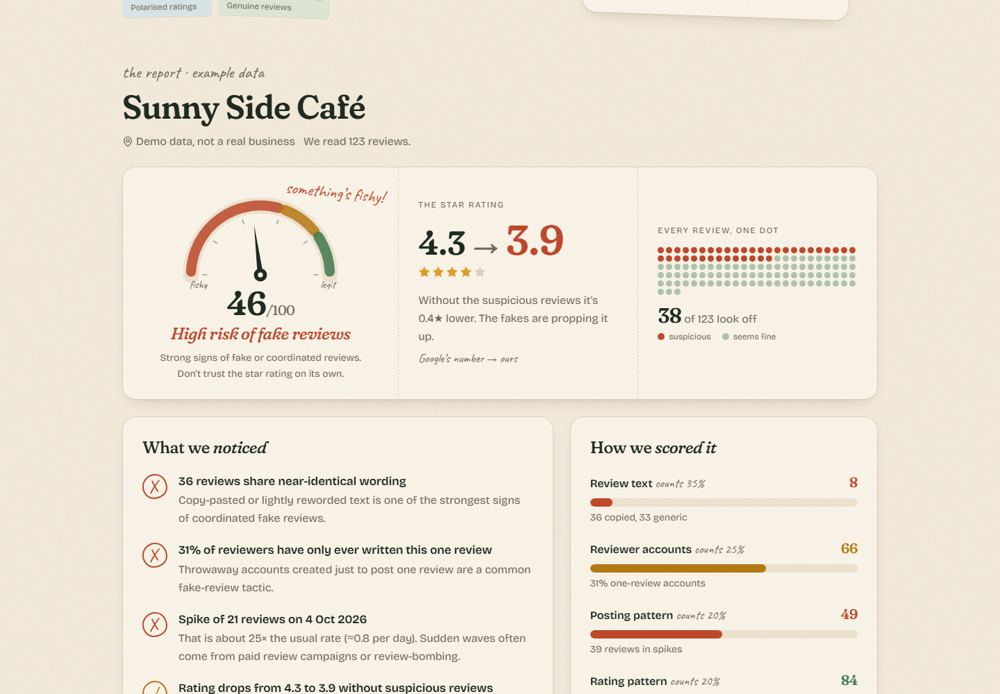
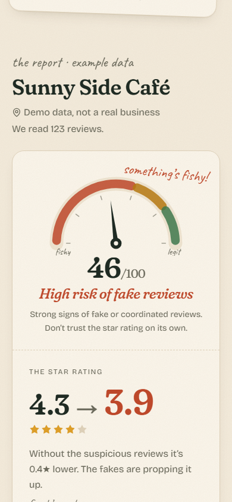
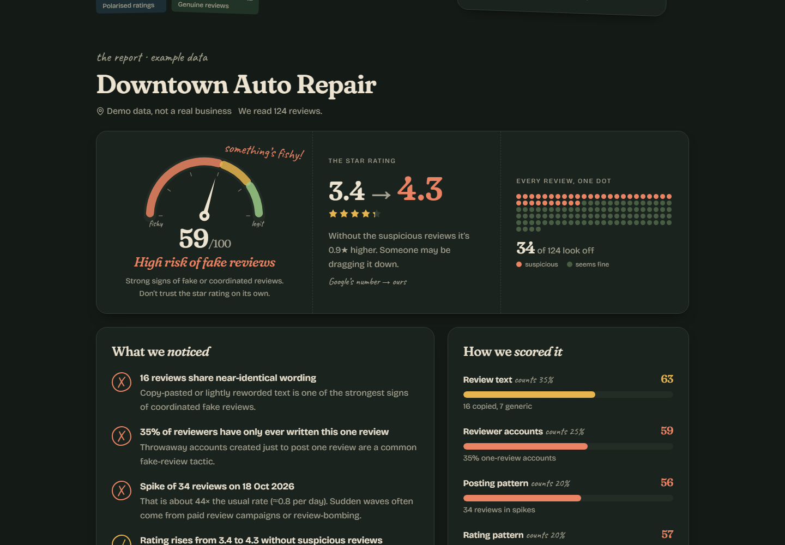

<div align="center">


# Sniff Test

**Do the reviews pass the sniff test?**
Paste a Google Maps link and sniff out fake reviews before you book.

[](https://github.com/anketghosh/sniff-test/actions/workflows/ci.yml)
[](LICENSE)


[](https://vercel.com/new/clone?repository-url=https%3A%2F%2Fgithub.com%2Fanketghosh%2Fsniff-test&project-name=sniff-test&repository-name=sniff-test)



</div>

---

## What it does

Sniff Test reads the most recent reviews of any place on Google Maps and looks for the usual tricks:

| | Check | What it catches |
|---|---|---|
| 01 | **Copy-paste praise** | Reviews with near-identical wording (TF-IDF cosine similarity) and short, generic template text |
| 02 | **One-hit accounts** | Reviewers who have only ever written a single review |
| 03 | **Sudden surges** | Days where reviews spike far above normal (Z-score on daily counts) |
| 04 | **Too-perfect ratings** | Polarised 1★/5★ splits, near-100% 5★, and how far flagged reviews move the average |

You get a **trust score** (0–100), Google's rating next to the rating **without the suspicious reviews**, and every review annotated with the reason it was flagged.

<table>
  <tr>
    <td></td>
    <td width="30%"></td>
  </tr>
  <tr>
    <td colspan="2"></td>
  </tr>
</table>

Try the built-in examples without any setup: `/?demo=botfarm`, `/?demo=bomb`, `/?demo=polarised`, `/?demo=organic`.

## Three ways to bring reviews in

| Mode | Cost | What the user needs |
|---|---|---|
| **Google Maps link** | [Apify](https://apify.com) free tier (about $5 credit a month, a few thousand reviews) | Their own free Apify key, added in the app, or one you set on the server |
| **Paste or upload** | Free | Reviews copied from Google Maps (the app shows how), or a CSV/JSON file. Runs entirely in the browser |
| **Demos** | Free | Nothing |

> **Why not scrape Google directly?** Google shows automated browsers a "limited view" with no reviews. Getting around that would mean evading bot detection, which this project deliberately doesn't do. See [Compliance](#compliance--limitations).

## Quick start

Requires **Node.js 20.9+** (24 recommended).

```bash
git clone https://github.com/anketghosh/sniff-test.git
cd sniff-test
npm install
npm run dev
```

Open <http://localhost:3000>. The demos and paste mode work straight away. For link checks, click **Apify key** under the search box and paste your key.

### Configuration

All optional. Copy `.env.example` to `.env.local`:

| Variable | Default | Purpose |
|---|---|---|
| `APIFY_TOKEN` | *(none)* | Server-wide Apify key so visitors don't need their own. A visitor's own key always takes priority. |
| `APIFY_ACTOR_ID` | `compass~google-maps-reviews-scraper` | Swap in another Apify actor with the same output format. |

> ⚠️ If you set `APIFY_TOKEN` on a public deployment, **every visitor's checks use your Apify credit**.

## Deploy

**Vercel (recommended).** Click the button above, or import the repo at [vercel.com/new](https://vercel.com/new). No settings are required. Every push to `main` redeploys automatically.

Full guide, including custom domains, the optional server key and the Docker/Render alternative: **[docs/DEPLOYMENT.md](docs/DEPLOYMENT.md)**.

## How it works

```
Google Maps link ──► /api/audit ──► Apify scraper ──► reviews ──┐
Pasted text / CSV / JSON ──► importers (in browser) ────────────┼──► analysis engine ──► report
Demo scenario ──► seeded generator (in browser) ────────────────┘
```

- **[docs/HOW-IT-WORKS.md](docs/HOW-IT-WORKS.md)**: the scoring method in plain language, with every threshold.
- **[docs/ARCHITECTURE.md](docs/ARCHITECTURE.md)**: code layout, data flow and API reference.

The whole engine is plain TypeScript in [`src/lib/analysis.ts`](src/lib/analysis.ts), with no ML dependencies, so it runs in the browser and on the server.

## Scripts

| Command | What it does |
|---|---|
| `npm run dev` | Start the dev server on port 3000 |
| `npm run build` | Production build (standalone output) |
| `npm start` | Serve the production build |
| `npm run lint` | ESLint |
| `npm run typecheck` | TypeScript, no emit |

## Compliance & limitations

- **Signals, not proof.** A flagged review can be genuine, and a clean score doesn't guarantee every review is real. The app says this on every report.
- **Data source.** Link checks rely on a third-party collector (Apify). Google's terms don't permit automated collection of its content. Apify handles the collecting, but you should get advice before running this commercially. Google's official Places API is fully compliant but returns only 5 reviews per place, which is too few for this analysis.
- **Sample.** Only the newest *N* reviews (50, 150 or 300) are analysed, so older manipulation can be missed.
- **Pasted reviews** carry no star ratings or exact dates, so those checks are skipped and the app says so.
- **Privacy.** Pasted and uploaded data never leaves the browser. Visitor Apify keys live in `localStorage` and are only forwarded to Apify. See [SECURITY.md](SECURITY.md).

## Contributing

Issues and pull requests are welcome. Please read [CONTRIBUTING.md](CONTRIBUTING.md) first.

## License

[MIT](LICENSE)
