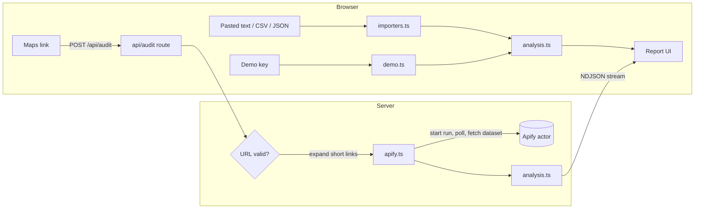

# Architecture

## Data flow



- **Paste, upload and demos run entirely in the browser.** Nothing is sent anywhere.
- **Link checks** go through the server so it can call Apify, cache results and stream progress back.

## Code layout

```
src/
  app/
    page.tsx                  renders <SniffTestApp/>
    layout.tsx                fonts (Fraunces, Bricolage Grotesque, Caveat), metadata
    globals.css               design tokens (light + dark), paper grain, helpers
    icon.svg                  favicon
    api/
      audit/route.ts          POST: link check, streams progress + result
      config/route.ts         GET: is a server Apify key configured?
      apify/verify/route.ts   POST: validates a visitor's key against Apify
  components/
    SniffTestApp.tsx          page shell, state machine, hero, progress, demo links
    SearchPanel.tsx           link / paste tabs, copy guide, demo tags
    ApifyKey.tsx              visitor key panel + localStorage store
    Results.tsx               report: trust meter, rating, dot grid, findings, charts
    ReviewList.tsx            filterable annotated review cards
    ui.tsx                    TrustMeter, Stars, Squiggle, verdict + severity styles
  lib/
    analysis.ts               the scoring engine (see HOW-IT-WORKS.md)
    apify.ts                  Apify client, URL validation (server only)
    importers.ts              CSV / JSON / Apify export / Google Maps text parsers
    demo.ts                   seeded demo scenarios
    types.ts                  shared types
```

## API reference

### `POST /api/audit`
Request body:
```json
{ "url": "https://maps.app.goo.gl/...", "maxReviews": 150, "refresh": false, "token": "apify_api_... (optional)" }
```
- `maxReviews` is clamped to 20–500.
- `token` is the visitor's own key. If it's missing, the server's `APIFY_TOKEN` is used.

The response is **NDJSON** (`application/x-ndjson`), one event per line:
```json
{"type":"progress","stage":"resolving|starting|scraping|analyzing","message":"..."}
{"type":"result","result":{ ...AuditResult },"cached":false}
{"type":"error","message":"human-readable reason"}
```
If the client disconnects, the server aborts the Apify run so credit isn't wasted.

### `POST /api/apify/verify`
Request `{ "token": "apify_api_..." }` → returns `{ "ok": true, "username": "..." }` or `{ "ok": false, "message": "..." }`. The key isn't stored.

### `GET /api/config`
Returns `{ "apify": boolean }`, which tells you whether a server-wide key exists. It never exposes the key.

## Security notes
- Short-link expansion follows redirects only for `maps.app.goo.gl`, `goo.gl` and `g.co`, and the final URL must be a Google Maps URL. This prevents the server being used to fetch arbitrary URLs.
- Visitor tokens are checked against `^[A-Za-z0-9_-]{10,200}$`, never logged, and only sent to `api.apify.com`.
- Errors shown to users are written messages; internal errors are logged on the server only.
